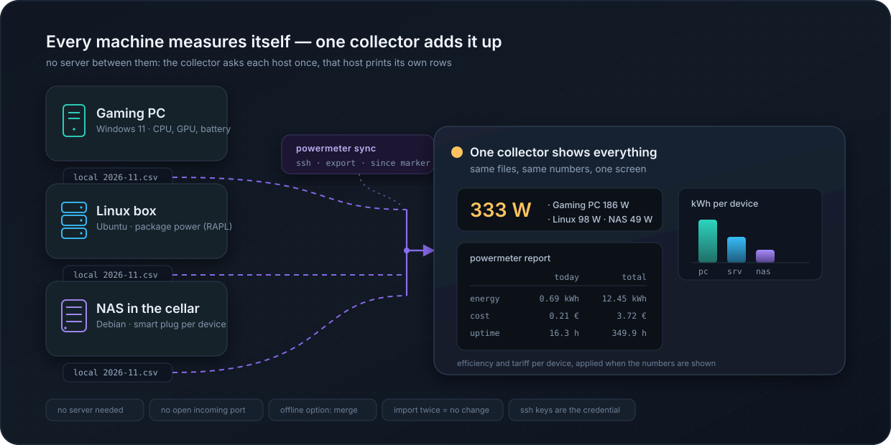
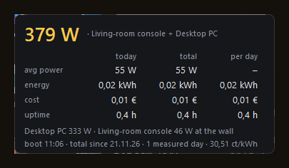
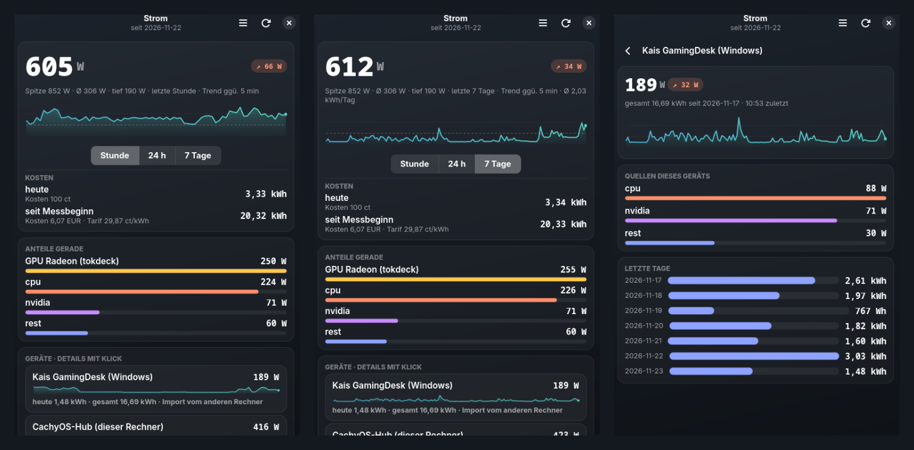
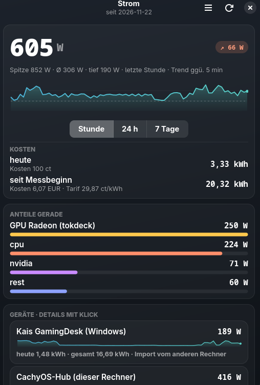
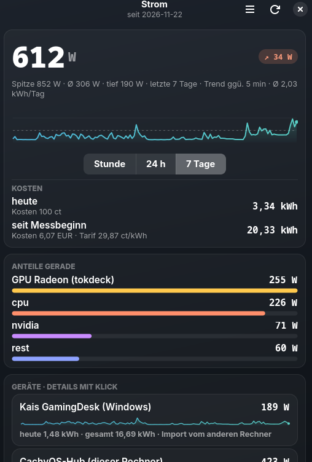
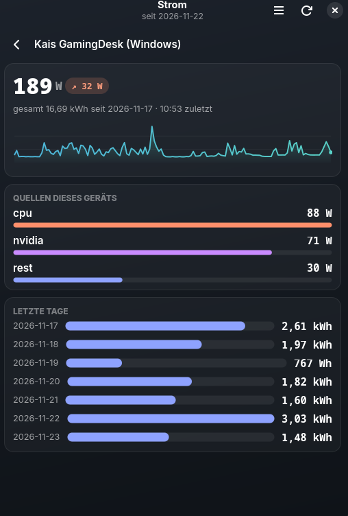
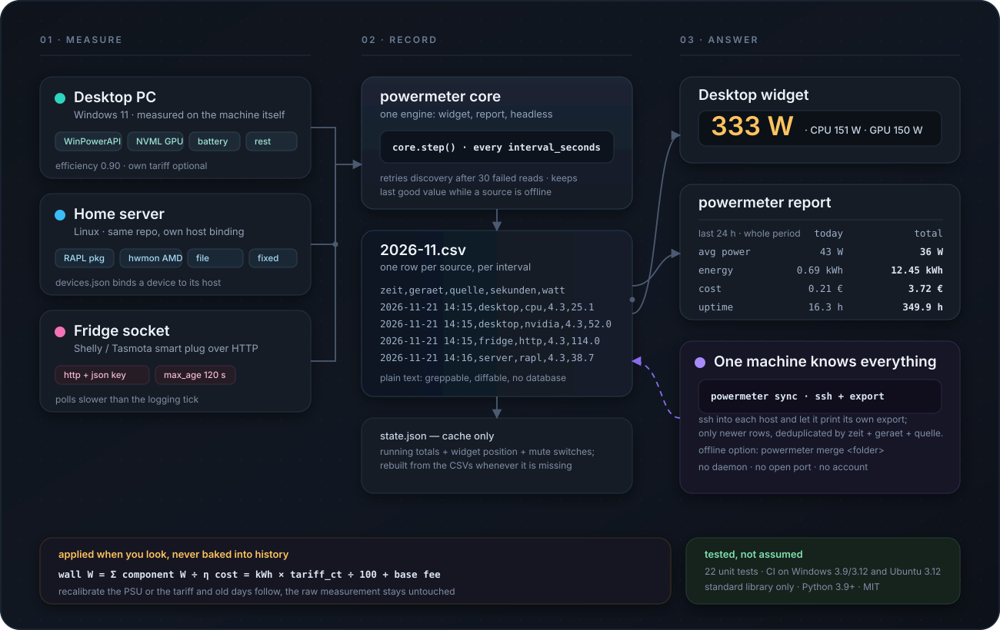

# powermeter

**Measure the power draw and the electricity cost of your computers — permanently, on
Windows and Linux, for one machine or several devices at once.**



*Three machines, one collector, no server in between — full size:
[docs/images/overview.svg](docs/images/overview.svg).*

| | |
|---|---|
| CI |  |
| License | [MIT](LICENSE) |
| Python | 3.9 – 3.13 (standard library only) |
| Operating systems | Windows 10/11, Linux (incl. WSL2) |

A borderless desktop widget shows live watts plus today / total / per-day energy, cost
and uptime. On Linux there is a second display, `powermeter widget`: a GTK4 window that
reads the same CSVs while the collector keeps running headless, so the desktop shows
power without Tk installed. A logger writes one CSV row per minute, and a CLI reports,
exports and merges the series. No daemon, no database, no inbound ports, no
third-party dependencies — Python's standard library only.




*Two configurations of the same widget on Windows 11: one device in compact mode, two
 devices with the detail table. The big number is the **live** wall-plug wattage; the
 table below reports averages over the measured time, today / total / per measured day.*



*The Linux display (`powermeter widget`, GTK4/Libadwaita) on GNOME, three views: total
 over the last hour, the same over seven days (with average kWh/day), and the detail page
 of one imported device. Every view shows the current total, the trend against five
 minutes ago, the curve of the selected range, cost, per-source shares and one row per
 device with its own mini curve; clicking a device opens its detail page and `Esc` or the
 back arrow returns. Live data from the machine this README was written on — the Windows
 PC reports in bursts (import), so its row shows the last measured value with its time
 instead of pretending a gap is 0 W.*

| hour range | 7 days | device detail |
|---|---|---|
| [](docs/images/widget-linux-uebersicht.png) | [](docs/images/widget-linux-7-tage.png) | [](docs/images/widget-linux-detail.png) |

## Why

Cheap power meters exist, but they usually need a kwhmeter daemon, an SQLite file, or a
sensor plug — and they never answer the two questions that actually matter: *what does
this machine cost me per day*, and *which part of it is the guilty one*. powermeter
answers both with the readings your CPU/GPU already publish, keeps the history in plain
CSV you can grep, and lets several machines report into one folder.

## Features

- **Live widget, no window chrome**: always-on-top, draggable, click-through friendly;
  compact two-line mode for one device, full table for several.
- **Display and collector can be separate processes**: `powermeter widget` (Linux,
  GTK4/Libadwaita) draws the selected range (hour / 24 h / 7 days) as a curve, per-source
  shares and one row per device with a mini curve; a click opens the device's detail
  page. It reads only — the measuring stays a `--headless` systemd service.
- **No invented zeros**: the current figure counts devices measured within the last five
  minutes; a device that reports in bursts (rows imported from another host) keeps its
  last value **with the timestamp**, and the total carries gaps up to ten minutes instead
  of saw-toothing on the import rhythm. Where nothing was measured the display shows `—`.
- **Per-device model**: each device has its own sources, PSU efficiency and (optionally)
  its own tariff — a desktop, a home server and a console measured on different boxes
  add up correctly.
- **Real sources**: CPU package power (RAPL on Linux, Windows power APIs), NVIDIA
  (NVML) and AMD (ADLX / hwmon), battery, smart plugs / Shelly / HTTP JSON, JSON or
  text files, fixed values, and a measured "rest" residual.
- **Even efficiency handling**: wall-plug watts = measured component watts / PSU
  efficiency; efficiency is applied at query time, so recalibrating does not rewrite
  history.
- **CSV history you can trust**: one tidy long row per interval, idempotent merging,
  automatic rebuild of running totals.
- **Multi-host**: `powermeter sync` pulls rows from other machines over SSH;
  `powermeter merge` imports folders (USB stick, sync folder). No server needed.
- **Headless**: `--headless`, systemd user units, Windows scheduled task, autostart.

## Installation

**Windows** (Python 3.9+ from python.org):

```bat
git clone https://github.com/KaiFelixBennett/powermeter.git
cd powermeter
py -m pip install -e .
powermeter scan
```

**Linux**:

```bash
git clone https://github.com/KaiFelixBennett/powermeter.git
cd powermeter
python3 -m pip install -e .        # optional; the module form below always works
python3 -m powermeter scan
```

No install step is required at all: `python3 -m powermeter …` runs from the checkout.

## Quick start

```bash
powermeter run            # logger + widget (falls back to logger-only without a display)
powermeter run --headless --duration 60   # 60 second measurement, then exit
powermeter report         # totals: today / total / per measured day
powermeter scan           # which sources are available on this machine
powermeter devices        # devices, their sources and host binding
powermeter autostart --enable             # start at login (Run key / .desktop file)
powermeter widget                # Linux display (GTK4), reads what the collector wrote
powermeter widget --bereich woche   # start on the 7-day curve (h | tag | woche)
powermeter widget --detail pc    # open one device's detail page directly
powermeter widget --autostart    # ... at login; --service also restarts it if it dies
powermeter import <folder> --device pc --geraet "Gaming Desk"
                                 # merge rows pushed in by another host (see
                                 # systemd/*.example: path trigger + 5 min timer)
```

## Usage

```console
$ powermeter report
                     today        total     per day
avg power             43 W         36 W           –
energy            0.69 kWh    12.45 kWh    1.56 kWh
cost                0.21 €        3.72 €      0.46 €
uptime              16.3 h      349.9 h      43.7 h

Devices (share):
  desktop           0.01 kWh     0.01 kWh             Desktop PC
  console           0.01 kWh     0.01 kWh             Living-room console 32.00 ct/kWh

1 measured day · 30.65 ct/kWh · Example Utility Co.
```

```console
$ powermeter sync
gamingpc: 20756 new rows, 0 duplicates (since 2026-11-21 14:47)
linuxbox: 0 new rows, 314 duplicates (since 2026-11-21 15:02)
```

Other commands: `export --month 2026-11 [--since "2026-11-20 06:00"] [--out file.csv]`,
`merge <folder> …`, `mute --source rest --device console`, `service install`,
`report --tag 2026-11-20`, `report --json`.

## Configuration

`config.json` (global) and `devices.json` (one entry per device) live next to the CSV
files: Windows `%LOCALAPPDATA%\powermeter`, Linux `~/.local/share/powermeter`.
Override the folder with `--data DIR` or `POWERMETER_DATA`.

| `config.json` key | Meaning | Default |
|---|---|---|
| `interval_seconds` | measurement interval | `60` |
| `price_ct_kwh` | cent per kWh | `30.0` |
| `daily_base_fee_eur` | grid/base fee per day | `0.0` |
| `include_base_fee` | add the base fee to costs | `false` |
| `tariff_name` | label shown in reports | `""` |
| `opacity` | widget window alpha (0.4–1) | `0.92` |
| `hosts` | remote hosts to pull from (see Multi-host) | `[]` |

```jsonc
// devices.json — English keys are the reference; the German names of v1 still work
{
  "devices": [
    { "id": "desktop", "name": "Desktop PC", "efficiency": 0.90,
      "sources": [{ "type": "auto" }] },
    { "id": "console", "name": "Living-room console", "efficiency": 0.92,
      "price_ct_kwh": 32.0,
      "sources": [{ "type": "fixed", "watts": 42.0, "label": "Smart plug" }] },
    { "id": "server", "name": "Home server", "host": "linuxbox",
      "sources": [{ "type": "rapl" }, { "type": "hwmon", "path": "/sys/class/drm/card1/device/hwmon/hwmon*/power1_average" }] },
    { "id": "shelly", "name": "Fridge socket", "efficiency": 1.0,
      "sources": [{ "type": "http", "url": "http://shelly1.local/status",
                    "key": "meters.0.power", "max_age_s": 120 }] }
  ]
}
```

Source types: `auto`, `rapl`, `nvml`, `adlx`, `hwmon`, `battery`, `http`, `file`,
`fixed`, `rest`. Switch a source or a whole device off without editing files:
`powermeter mute --source rest`, `powermeter mute --device console`,
`powermeter mute --show`, or the widget's right-click menu.

## How it works



*(full size: [docs/images/architecture.svg](docs/images/architecture.svg) — open it in a
 browser tab, it scales without losing a pixel)*

*One engine, one plain-text history, many front ends. Sources are read per device each
interval; every reading becomes one CSV row. The widget, `report`, `export` and `sync`
all consume those same files, and efficiency plus prices are applied when you look at
the numbers — never written into history, so recalibrating never rewrites measurements.*

Each row records *when*, *which device*, *which source*, *for how many seconds* and
*how many watts*. Adding a new source type never changes the schema. A terminal-friendly
version of the diagram is in [docs/ARCHITECTURE.md](docs/ARCHITECTURE.md).

## Data format

`YYYY-MM.csv`, header `zeit,geraet,quelle,sekunden,watt`:

```csv
zeit,geraet,quelle,sekunden,watt
2026-11-21 14:15,desktop,cpu,4.3,25.1
2026-11-21 14:15,desktop,nvidia,4.3,52.0
```

Rows are unique by `(zeit, geraet, quelle)`; importing the same file twice is a no-op.
`state.json` only caches running totals and the widget's window state and is rebuilt
from the CSVs when missing. The pre-1.0 layout (`cpu_w,nvidia_w,amd_w,rest_w,…`) is
read and migrated automatically.

## Multiple machines

Every machine measures itself; nothing is sent anywhere. To get one place that knows
everything, pick a collector:

1. **Over SSH (recommended)** — the collector asks the other machine to print its own
   export, then appends it, deduplicated and incrementally:

   ```jsonc
   // config.json on the collector
   "hosts": [
     { "name": "gamingpc", "host": "you@192.168.1.20",
       "python": "python", "data": "C:/Users/you/AppData/Local/powermeter" },
     { "name": "linuxbox", "host": "you@192.168.1.30",
       "data": "/home/you/.local/share/powermeter" }
   ]
   ```

   ```bash
   powermeter sync            # pulls new rows only; keeps a marker per host
   powermeter sync --list     # show the configured hosts and the exact commands
   powermeter sync --command "ssh you@host cat 2026-11.csv"   # any CSV-on-stdout command
   ```

2. **By file** — copy the folder (USB stick, Syncthing, network share) and run
   `powermeter merge <folder>`.

Keep device ids unique per machine; `sync` warns if the same id exists on both hosts.
Set `POWERMETER_HOSTNAME` when a VM copies its host's name (WSL2 does).

**Keeping the collector fresh.** If the other machine pushes files instead of being
pulled (a scheduled task copying CSVs over SSH), merge them as soon as they land: the
`systemd/powermeter-import.path.example` unit reacts to the file arriving, and
`powermeter-import.timer.example` runs the same service every five minutes as a
backstop. Without the path unit a fifteen-minute push waits on a fifteen-minute timer,
which makes the second machine look idle in the display.

## Platform support

| Source | Windows 10/11 | Linux | macOS |
|---|---|---|---|
| CPU package power | ✅ Windows power APIs | ✅ RAPL (`/sys/class/powercap`, may need the udev rule below) | ❌ not implemented |
| NVIDIA GPU | ✅ NVML | ✅ NVML (driver exposed, e.g. in WSL2) | ❌ |
| AMD GPU | ✅ ADLX | ✅ hwmon | ❌ |
| Battery | ✅ | ✅ `/sys/class/power_supply` | ❌ |
| Smart plug / Shelly / HTTP JSON | ✅ | ✅ | ✅ |
| File / fixed value / measured rest | ✅ | ✅ | ✅ |
| Widget (Tk) | ✅ | ✅ X11/Wayland, needs Tk | ⚠️ untested |
| Display (GTK4, `powermeter widget`) | ❌ | ✅ X11/Wayland, no Tk needed | ❌ |
| Autostart / service | Run key + scheduled task | `.desktop` + systemd user unit | ❌ |

Everything in the ✅ rows was executed on real hardware in CI or on the machines
mentioned in the screenshots; ⚠️/❌ are honest gaps, pull requests welcome.

## Development

```bash
python3 -m pytest -q          # 35 tests, no network, no admin rights
```

CI runs that suite on `windows-latest` (Python 3.9 and 3.12) and `ubuntu-latest`
(Python 3.12). See [CONTRIBUTING.md](CONTRIBUTING.md) and
[docs/ARCHITECTURE.md](docs/ARCHITECTURE.md).

### Pictures are reproducible

The Linux screenshots are not hand-drawn crops. `tools/screenshot_linux.py` drives the
running display through its own D-Bus actions (`bereich`, `detail`, `zurueck`, `marke`,
`groesse`), records the whole screen through the XDG portal (Wayland tells a window
neither its position nor its size, and the portal has no single-window mode), and takes
the window frame from the display's own 6 px marker ring — so the crop is the whole
window instead of a guess from desktop colours. `--komponiere` lays several views side by
side at one height.

```bash
python3 tools/screenshot_linux.py --zurueck --bereich h --aus docs/images/a.png
python3 tools/screenshot_linux.py --detail pc           --aus docs/images/b.png
python3 tools/screenshot_linux.py --komponiere docs/images/a.png docs/images/b.png \
        --aus docs/images/serie.png --hoehe 700
```

## Troubleshooting

| Symptom | Cause and fix |
|---|---|
| `scan` shows no CPU source on Linux | RAPL files are root-owned: `echo 'SUBSYSTEM=="powercap", MODE="0444"' \| sudo tee /etc/udev/rules.d/99-powercap.rules && sudo udevadm control --reload && sudo udevadm trigger` |
| `No source could be created on this machine` | Wrong source type for that OS, or the device is bound to another `host` — check `powermeter devices` and `data/error.log` |
| Two hosts produce the same device name in reports | `sync` prints `WARNING: device ids …`; give each machine its own ids |
| WSL2 measures as the Windows host | `export POWERMETER_HOSTNAME=linuxbox` |
| Widget missing under GNOME/KDE | the window is a borderless top-level; look for it in the window list, or run `powermeter run --headless` |
| Nothing happens when starting twice | one logger per data folder is enforced; use separate `--data` folders |
| The Linux display closes itself when a button is clicked | fixed in the current version: the range buttons were wired to `toggled` and re-activated each other until the stack overflowed (`RecursionError`, the desktop reports it as "is not responding") |
| The second machine shows `—` or is missing from the total | its rows have not been merged yet — see the import path/timer units above; a device measured more than five minutes ago is deliberately not counted as "now" |

## Limitations

- Countertop sensors are only as good as what the firmware publishes: idle-package
  power on some AMD mobiles is unavailable, and the whole-system "rest" figure is a
  measurement, not a model, where the platform allows it.
- Number formatting, currency sign and log messages are still partly German-flavoured;
  the UI, CLI and docs are English, and a `--lang` switch is planned.
- No macOS sources yet.

## License

[MIT](LICENSE). Screenshots taken on Windows 11 with the demo configuration in
`docs/images/`.
